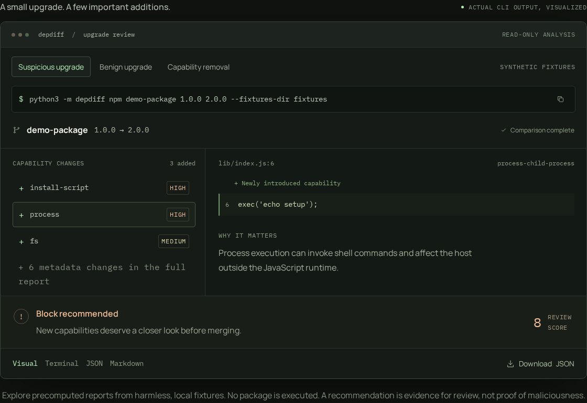
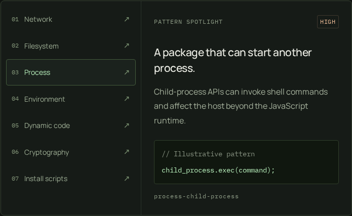
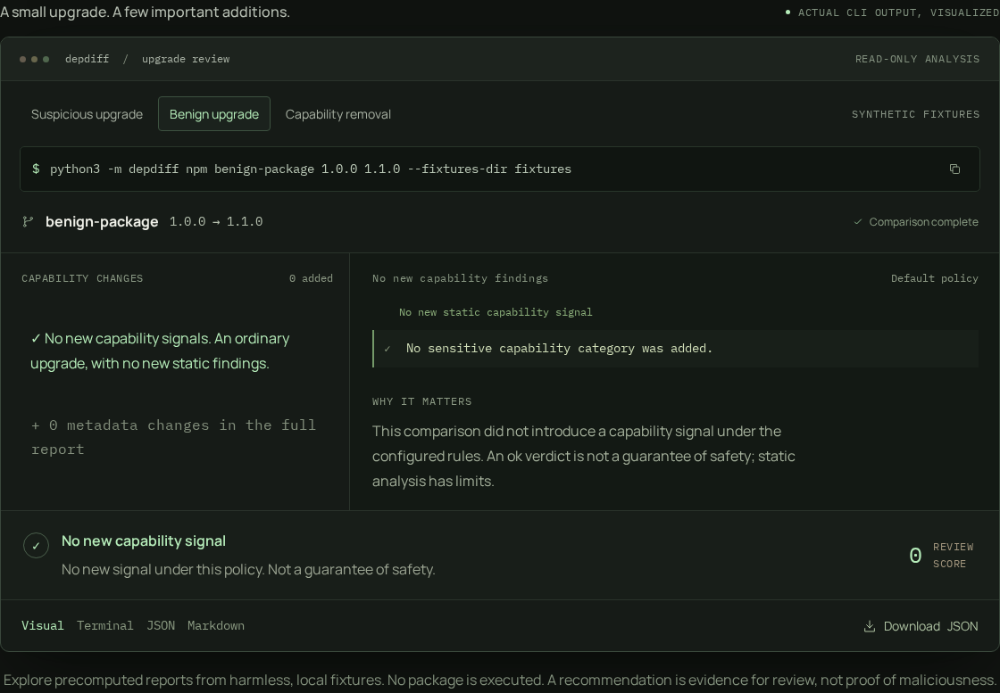

<div align="center">
  
  <h1>depdiff</h1>
  <p><strong>Small update. Different behavior.</strong></p>
  <p>Behavioral dependency security &amp; upgrade reviews.<br>See what changed behind the version number, before you merge.</p>
  <p>
    <a href="https://depdiff.vercel.app/#demo"><strong>Explore the live demo</strong></a>
    &nbsp;·&nbsp; <a href="#quick-start">Quick start</a>
    &nbsp;·&nbsp; <a href="#cli-and-reports">CLI reference</a>
    &nbsp;·&nbsp; <a href="video/README.md">Demo video</a>
  </p>
  <p><code>Python 3.11.2</code> &nbsp; <code>Local-first</code> &nbsp; <code>No runtime dependencies</code> &nbsp; <code>MIT</code></p>
</div>

---

**The version number changed. What else did?** depdiff compares two versions of
an npm dependency and explains changes in package metadata and statically
visible JavaScript capabilities. Get exact evidence, deterministic scores, and
a review recommendation instead of another unexplained alert.

[](https://depdiff.vercel.app/#demo)

<p align="center"><sub>The repository's own demo, using harmless local fixtures. Click the image to explore.</sub></p>

| **7** capability categories | **3** shareable report formats | **0** package code executed |
| :---: | :---: | :---: |
| From network access to install scripts | Terminal · JSON · Markdown | Read-only analysis on your machine |

> [!NOTE]
> Evidence for review, not proof of maliciousness or safety. The website shows
> precomputed reports; use the CLI to analyze your own local package versions.

**On this page:** [Why depdiff?](#why-use-it) · [Features](#implemented-mvp) ·
[Quick start](#quick-start) · [Reports](#cli-and-reports) ·
[Rules](#rules-and-static-analysis) · [Docker](#docker) ·
[Testing](#testing-and-reproducibility) · [Limitations](#security-model-and-limitations)

---

## Why use it

Vulnerability databases and update bots answer important questions, but they do
not always show behavioral differences between two package versions. depdiff
adds a local, version-to-version view of:

- lifecycle installation scripts;
- dependency and entry-point metadata changes;
- newly visible network, filesystem, process, environment, dynamic-code, and
  cryptographic capabilities;
- exact source locations, line numbers, evidence snippets, and review reasons.

It complements `npm audit`, Dependabot, Snyk, and similar tools. Those tools can
identify known advisories, outdated packages, or broader dependency risk.
depdiff focuses on explainable behavioral deltas, including changes that do not
yet have a known CVE. It is not a replacement for those tools.

## Implemented MVP

| What you do | What depdiff gives you |
| --- | --- |
| **Compare an upgrade** | Python CLI: `depdiff npm <package> <old-version> <new-version>`. Offline fixtures with package name/version validation. |
| **Read the metadata** | Lifecycle scripts, dependency sections, and `main`, `bin`, and `exports` entry-point changes in `package.json`. |
| **Spot new capabilities** | Read-only regex scanning of `.js`, `.mjs`, `.cjs`, and `.jsx`, using external YAML rules. Classifies added, removed, and unchanged categories. |
| **Follow the evidence** | Category, rule ID, severity, source file, line number, snippet, and a reason for each finding. |
| **Make a review decision** | Deterministic scores and `ok`, `review`, or `block-recommended` policy recommendations. |
| **Share the result** | Terminal output, structured JSON, and pull-request-friendly Markdown. |
| **Keep analysis contained** | Safe fixture paths, file-count and size limits, plus tar extraction helpers that reject traversal, links, and special files. No package execution. |

The core uses only Python's standard library, with offline tests and a pinned
Docker image definition. The showcase and video are optional ways to explore it.

### A closer look at capabilities

<p align="center">
  
</p>

**Network · Filesystem · Process · Environment · Dynamic code · Cryptography · Install scripts**

Inspect the source pattern and its review context, then
[read or extend the detection rules](rules/default.yaml). The explorer shows
illustrative patterns, not runtime tracing.

## Quick start

Use **Python 3.11.x** and `make`, or follow the [clean-machine Docker workflow](#docker).
Python 3.11.2 is the repository's reproducibility baseline. No API keys, package
installation, or external service are needed for the demos.

```sh
git clone https://github.com/ashin-15/DepDiff.git
cd DepDiff
python3.11 -m depdiff npm demo-package 1.0.0 2.0.0 --fixtures-dir fixtures
```

The repository pins Python with `.python-version` and uses no third-party
runtime or test dependencies. `requirements.lock` is intentionally an empty
lockfile because the project uses only the Python standard library. From the
repository root:

```console
$ make test
$ make demo-suspicious
$ make demo-benign
$ make demo-markdown
```

### Two upgrades. Different signals.

**Suspicious upgrade: `demo-package 1.0.0 → 2.0.0`**

The synthetic upgrade introduces a `postinstall` script, filesystem access,
and child-process execution. The output includes evidence and recommends
`block-recommended`. The fixture is harmless and is never executed.

**Benign upgrade: `benign-package 1.0.0 → 1.1.0`**

The benign scenario remains `ok`, with no newly detected capability signal:

```console
$ python3.11 -m depdiff npm benign-package 1.0.0 1.1.0 --fixtures-dir fixtures
```

<details>
<summary><strong>See the benign comparison</strong></summary>



An ordinary implementation change can remain `ok`. That means no new signal
under the configured rules, not a guarantee of safety.

</details>

## Installation

The core package supports CPython `>=3.11,<3.12`. The repository uses Python
3.11.2 as its reproducibility baseline, but any Python 3.11.x interpreter is
supported. The CLI has no third-party runtime dependencies and the installer
does not download packages from an index.

### Recommended: install with the script

The single installation script creates an isolated virtual environment and
adds a `depdiff` command to a user-local prefix. It does not modify the
system-managed Python and does not require `sudo`:

```console
$ git clone https://github.com/ashin-15/DepDiff.git
$ cd DepDiff
$ PYTHON_BIN=python3.11 PREFIX="$HOME/.local" scripts/install.sh
$ export PATH="$HOME/.local/bin:$PATH"
$ depdiff --version
```

The script is safe to run again. It updates the virtual environment's package
and replaces its own command symlink, but refuses to overwrite an existing
non-symlink at the destination. Use `scripts/install.sh --help` for all
environment overrides.

For a system-wide command, choose the prefix and virtual environment location
explicitly and run the same script with privileges:

```console
$ sudo env PYTHON_BIN=python3.11 PREFIX=/usr/local \
    VENV_DIR=/opt/depdiff/venv scripts/install.sh
$ /usr/local/bin/depdiff --help
```

The script expects Python 3.11 and its `venv` module to already be installed;
it does not install operating-system packages. On Debian-based systems, the
package providing that module is commonly named `python3.11-venv`. Package
names vary by distribution.

### Other installation and usage methods

For local development, running the module directly from the checkout does not
require installation:

```console
$ python3.11 -m depdiff npm demo-package 1.0.0 2.0.0 --fixtures-dir fixtures
```

To install the console command into a project-local virtual environment:

```console
$ python3.11 -m venv .venv
$ .venv/bin/python -m pip install --no-index --no-deps .
$ .venv/bin/depdiff --help
```

The package can also be run in Docker without installing Python on the host;
see the [Docker workflow](#docker) below. The installation script is a POSIX
shell script. On Windows, use the equivalent project-local virtual environment
commands from PowerShell:

```powershell
PS> py -3.11 -m venv .venv
PS> .venv\Scripts\python.exe -m pip install --no-index --no-deps .
PS> .venv\Scripts\depdiff.exe --help
```

The `.env.example` file contains only non-secret process defaults. depdiff does
not require an `.env` file, API key, database, or other external service.

The project-local PEP 517 backend has no build requirements, so this command
does not need a package index. The same package can be built and installed in a
clean Python 3.11.x environment.

## CLI and reports

```console
$ depdiff npm --help
$ depdiff npm demo-package 1.0.0 2.0.0 --fixtures-dir fixtures
$ depdiff npm demo-package 1.0.0 2.0.0 \
    --fixtures-dir fixtures --format json --output reports/review.json
$ depdiff npm demo-package 1.0.0 2.0.0 \
    --fixtures-dir fixtures --format markdown --output reports/review.md
```

| Option | Purpose |
| --- | --- |
| `--fixtures-dir PATH` | Local root containing `npm/<package>/<version>`. |
| `--rules PATH` | Replace the shipped rules with a local YAML rule file. |
| `--format terminal\|json\|markdown` | Choose the report format. |
| `--output PATH` | Write a report to a file, creating parent directories. |

### Read the recommendation

| Verdict | How to use it |
| --- | --- |
| `ok` | No new capability signal under the configured policy. Not a guarantee of safety. |
| `review` | Inspect the reported evidence before accepting the change. |
| `block-recommended` | The policy recommends blocking pending closer human review. Not proof of maliciousness. |

Execution failures, such as a missing fixture or invalid rule file, return a
nonzero exit code. A security verdict is printed as report data and does not
itself turn a successful analysis into an execution failure.

The JSON report has stable field names and ordering. Markdown is suitable for
attaching to a dependency-update pull request. Terminal output is intentionally
concise but includes evidence locations and assessment reasons.

## Offline fixture layout

```text
fixtures/
└── npm/
    └── <package-name>/
        └── <version>/
            ├── package.json
            └── source files
```

Scoped npm names use two path components, for example
`fixtures/npm/@scope/name/1.0.0/package.json`. The loader validates that the
metadata name and version match the requested fixture. It rejects traversal,
escaping paths, symlinks, oversized metadata, malformed JSON, and fixture
trees over configured file/size limits.

The implementation never runs `npm install`, lifecycle scripts, JavaScript,
imports, subprocesses, or downloaded package code. It makes no network request.

## Rules and static analysis

Default rules are in [`rules/default.yaml`](rules/default.yaml). The loader
supports a deliberately small, reviewable YAML subset with:

```yaml
version: 1
rules:
  - id: custom-network
    capability: network
    severity: MEDIUM
    pattern: '\\brequest\\s*\\('
    description: 'Finds a custom request call.'
    reason: 'Network access deserves review.'
```

Each rule requires a unique `id`, `capability`, `severity`, `pattern`, and
`description`. Optional `reason`, `source`, and regex `flags` are supported.
`source` is `javascript` by default or `metadata` for lifecycle entries. The
seven shipped capability categories are `network`, `fs`, `process`, `env`,
`dynamic-code`, `crypto`, and `install-script`.

The scanner is intentionally lightweight regular-expression analysis. It can
produce false positives in comments, strings, aliases, generated code, or
unusual formatting, and can miss obfuscation, dynamic API selection, and
runtime-only behavior. It is not an AST or runtime sandbox.

## Architecture

```text
CLI
  -> FixtureStore and metadata validation
  -> YAML RuleSet
  -> read-only JavaScript and lifecycle scanning
  -> metadata and capability diffing
  -> deterministic scoring/verdict
  -> terminal, JSON, or Markdown reporter
```

Details and extension points are in [`ARCHITECTURE.md`](ARCHITECTURE.md).

### Explore the repository

| If you want to... | Start here |
| --- | --- |
| Walk through the offline scenarios | [Demo guide](docs/demo.md) |
| See example report output | [Checked-in reports](docs/examples/) |
| Understand the implementation | [Architecture and extension points](ARCHITECTURE.md) |
| Preview or deploy the website | [Showcase guide](docs/showcase.md) |
| Rebuild the README screenshots | [Image sources and capture steps](docs/images/README.md) |
| Rebuild the 52-second demo video | [Video source and render guide](video/README.md) |

## Docker

### Rebuild from a clean Linux machine

The Docker workflow is the canonical rebuild path when the host does not have
Python or the project tools installed. Run the following from the root of a
clean checkout.

The Dockerfile uses the pinned `python:3.11.2-slim-bookworm` base image, installs
the local package without an index, and runs as a non-root user:

```console
$ docker build --tag depdiff:local .
$ docker run --rm depdiff:local npm demo-package 1.0.0 2.0.0 \
    --fixtures-dir /app/fixtures
$ docker run --rm depdiff:local --help
$ docker run --rm --entrypoint python depdiff:local \
    -m unittest discover --start-directory /app/tests --verbose
```

The image build needs the pinned base image available locally or access to the
container registry for that base layer. Runtime analysis and the full test
suite use only files included in this repository and require no network. The
`.dockerignore` file excludes Git metadata, local virtual environments,
generated reports, caches, and `.env` files from the build context.

## Testing and reproducibility

Run the one project test command:

```console
$ make test
```

The suite covers metadata parsing and diffs, rule validation, positive and
negative capability fixtures, capability classification, scoring, all report
formats, CLI failures, offline execution, safe archive handling, and
reproducible wheel builds. Tests use synthetic harmless samples and do not
execute them.

Optional [real-browser checks](docs/showcase.md#optional-real-browser-checks)
cover the interactive showcase, responsive typography, and automated
accessibility checks. The [README images](docs/images/README.md) are captured
from that same local showcase using only repository-hosted assets.

## Security model and limitations

depdiff is evidence for human review. `ok` means that the configured static
analysis found no newly introduced capability signal under the default policy;
it is not a guarantee of safety. `review` and `block-recommended` are policy
recommendations, not proof of maliciousness.

The MVP does not retrieve npm registry packages, inspect lockfile-wide graphs,
perform dynamic tracing, run a sandbox, or prove semantic equivalence. Tar
archive validation is available for safe static materialization, but no package
archive is installed or executed.

## Planned improvements

Possible follow-on work includes verified npm registry retrieval and caching,
more AST-aware analysis, obfuscation indicators, allowlists, SARIF output,
lockfile-wide comparison, and CI integrations. These are intentionally outside
the current offline MVP.

## License

MIT. See the project metadata for the current package version.

---

<p align="center"><strong>Know what changed. Then decide.</strong><br><a href="https://depdiff.vercel.app/#demo">Explore the demo</a> · <a href="#quick-start">Try it locally</a> · <a href="https://github.com/ashin-15/DepDiff">View on GitHub</a></p>
